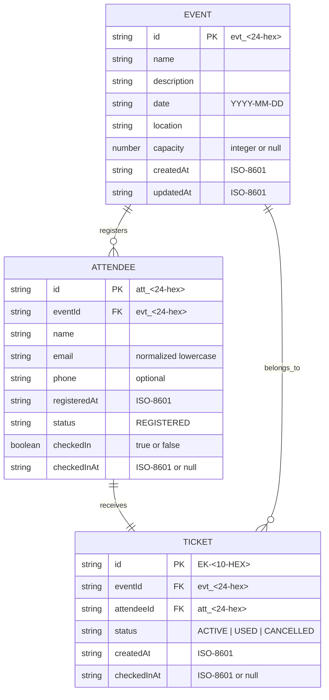
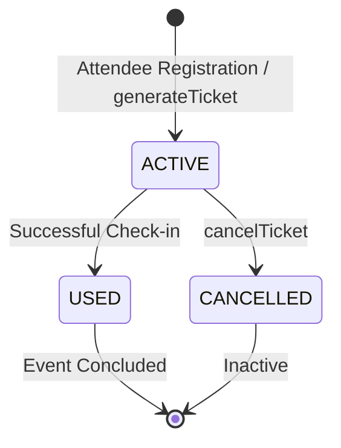

# EventKit

A lightweight, zero-database Node.js toolkit for event registration, digital ticketing, QR code generation, ticket validation, attendee check-in, attendance analytics, search, and data export.

[](https://github.com/nsaky/eventkit/actions/workflows/tests.yml)
[](https://www.npmjs.com/package/eventkit)
[](https://opensource.org/licenses/MIT)
[](https://nodejs.org)

---

## 1. Introduction

Developers building event platforms, hackathons, college fests, conferences, and community meetups frequently need to implement repetitive infrastructure: participant registration, duplicate prevention, ticket generation, scannable QR codes, arrival check-in, real-time statistics, and roster exports.

**EventKit** eliminates this boilerplate by providing a modular, self-contained Node.js toolkit backed by persistent local JSON storage. Without requiring external database servers, cloud credentials, or proprietary SDKs, EventKit provides a clean, asynchronous Promise-based API for end-to-end event management.

### Target Use Cases
- College festivals and university technical symposiums
- Hackathons and coding competitions
- Technology summits, conferences, and seminars
- Workshops, masterclasses, and hands-on labs
- Startup demo days and community meetups
- Small-to-medium registration-based event platforms

---

## 2. Feature Overview

- **Zero-Database Persistent Storage**: Maintains local JSON files (`events.json`, `attendees.json`, `tickets.json`) with atomic writes via temporary files and automatic schema initialization.
- **Write Serialization**: Built-in async mutex lock (`runExclusive`) and atomic batch operations (`saveBatch`) to prevent concurrent write collisions.
- **Event Management**: Create, retrieve, list, update, and delete events. Enforces capacity floors and cascades deletions to associated attendees and tickets.
- **Attendee Registration**: Schema validation, email normalization (`trim` + `toLowerCase`), duplicate registration prevention per event, and capacity enforcement.
- **Digital Ticketing**: Automatic ticket generation (`EK-<10-HEX>`) upon registration, standalone ticket issuance, and safe ticket cancellation.
- **Scannable QR Codes**: Generate scannable QR codes in **PNG** (Buffer) and **SVG** (vector string) formats encoding minimal identifiers (`{ ticketId, eventId }`) without exposing attendee personal data. Supports saving directly to disk with overwrite protection.
- **Non-Destructive Ticket Validation**: Authenticate tickets before check-in, reporting structured states: `VALID`, `INVALID`, `WRONG_EVENT`, `ALREADY_CHECKED_IN`, and `CANCELLED`.
- **Atomic Attendee Check-In**: Synchronized check-in updating ticket status to `USED` and attendee `checkedIn` to `true`, preventing duplicate check-ins and recording precise arrival timestamps.
- **Real-Time Attendance Analytics**: Computes total registrations, checked-in count, pending count, attendance rate, and capacity fill rate without division-by-zero risks.
- **Search Engine**: Case-insensitive substring search by attendee name, email, or ticket ID, with filters for attendance status.
- **Data Export System**: Full JSON snapshots and RFC 4180 compliant CSV exports with proper escaping of commas, quotation marks, line breaks, and Unicode text.

---

## 3. Installation

Install via npm:

```bash
npm install eventkit
```

---

## 4. Requirements

- **Runtime**: Node.js `>= 22.0.0` (active LTS releases: Node.js 22, 24, 26)
- **Module System**: CommonJS (`require` / `module.exports`)
- **Dependencies**: Minimal footprint (depends only on `qrcode` for QR rendering)

---

## 5. Quick Start

```javascript
const EventKit = require('eventkit');

async function main() {
  // 1. Initialize EventKit with storage directory
  await EventKit.initialize({ storagePath: './my-event-data' });

  // 2. Create an event
  const event = await EventKit.createEvent({
    name: 'Tech Summit 2026',
    description: 'Annual technology conference',
    date: '2026-12-15',
    location: 'Pune',
    capacity: 200
  });

  // 3. Register an attendee (automatically generates a ticket)
  const attendee = await EventKit.registerAttendee(event.id, {
    name: 'Jane Doe',
    email: 'jane@example.com',
    phone: '+919876543210'
  });
  console.log(`Registered: ${attendee.name}, Ticket ID: ${attendee.ticket.id}`);

  // 4. Generate QR code (PNG Buffer or write to file)
  const qr = await EventKit.generateQRCode(attendee.ticket.id, {
    format: 'png',
    filePath: './tickets/jane-ticket.png',
    overwrite: true
  });
  console.log(`QR code saved to: ${qr.filePath}`);

  // 5. Validate ticket before check-in
  const validation = await EventKit.validateTicket(event.id, attendee.ticket.id);
  console.log(`Validation status: ${validation.status}`); // 'VALID'

  // 6. Check in attendee
  const checkIn = await EventKit.checkIn(event.id, attendee.ticket.id);
  console.log(`Check-in successful at: ${checkIn.checkedInAt}`);

  // 7. Get real-time attendance statistics
  const stats = await EventKit.getAttendanceStats(event.id);
  console.log(`Attendance: ${stats.totalCheckedIn}/${stats.totalRegistrations} (${stats.attendancePercentage}%)`);

  // 8. Search attendees
  const searchResults = await EventKit.searchAttendees(event.id, 'jane', { checkedIn: true });
  console.log(`Found ${searchResults.length} checked-in attendee(s).`);

  // 9. Export attendee roster to CSV
  const csv = await EventKit.exportAttendees(event.id, 'csv', {
    filePath: './exports/attendees.csv',
    overwrite: true
  });
  console.log(`Exported attendees to CSV: ${csv.filePath}`);
}

main().catch(console.error);
```

---

## 6. Initialization & Storage Configuration

EventKit initializes its storage directory automatically on the first call to `EventKit.initialize()`.

```javascript
await EventKit.initialize({
  storagePath: './custom-event-data' // Optional, defaults to './eventkit-data'
});
```

- **Storage Location**: Relative paths are consistently resolved against `process.cwd()`.
- **Automatic File Creation**: Missing JSON files (`events.json`, `attendees.json`, `tickets.json`) are initialized with empty arrays `[]`.
- **Reinitialization Safety**: Calling `initialize()` multiple times is safe. Reinitializing with a different path cleanly re-binds storage and flushes the in-memory cache without stale data leaks.
- **Corruption Resilience**: If a storage file contains malformed JSON or non-array root structures, initialization fails with a `StorageCorruptedError` and **never** destroys or overwrites the corrupted file.

---

## 7. Complete API Reference

All API methods are asynchronous and return Promises. Methods return safe deep copies to prevent external callers from modifying internal in-memory records.

### 7.1 Initialization

#### `EventKit.initialize(options)`
Initializes the JSON storage engine and domain services.
- **Parameters**:
  - `options.storagePath` *(string, optional)*: Target directory path (default: `'./eventkit-data'`).
- **Returns**: `Promise<void>`
- **Errors**: `StorageCorruptedError`, `StorageError`

---

### 7.2 Event Management

#### `EventKit.createEvent(data)`
Creates a new event record with a generated unique ID (`evt_<24-hex>`).
- **Parameters**:
  - `data.name` *(string, required)*: Non-empty event name.
  - `data.date` *(string, required)*: Calendar date in `YYYY-MM-DD` format (validated against calendar correctness).
  - `data.description` *(string, optional)*: Event description (or `null`).
  - `data.location` *(string, optional)*: Event venue/location (or `null`).
  - `data.capacity` *(number, optional)*: Positive integer for maximum allowed attendees, or `null` for unlimited capacity.
- **Returns**: `Promise<Event>`
- **Errors**: `InvalidEventDataError`, `NotInitializedError`

#### `EventKit.getEvent(eventId)`
Retrieves an event by its unique ID.
- **Parameters**:
  - `eventId` *(string, required)*: Event ID starting with `evt_`.
- **Returns**: `Promise<Event|null>`

#### `EventKit.getAllEvents()`
Retrieves all stored event records.
- **Returns**: `Promise<Array<Event>>`

#### `EventKit.updateEvent(eventId, updates)`
Updates permitted event fields (`name`, `date`, `description`, `location`, `capacity`).
- **Notes**: Modifying `id` or `createdAt` is forbidden. Capacity cannot be reduced below the current registration count.
- **Returns**: `Promise<Event>`
- **Errors**: `EventNotFoundError`, `InvalidEventDataError`, `InvalidEventIdError`

#### `EventKit.deleteEvent(eventId)`
Deletes an event and cascade-deletes all associated attendees and tickets atomically.
- **Returns**: `Promise<Event>` (deleted event record)
- **Errors**: `EventNotFoundError`, `InvalidEventIdError`

---

### 7.3 Attendee Management

#### `EventKit.registerAttendee(eventId, attendeeData)`
Registers an attendee for an event and automatically creates an associated digital ticket.
- **Parameters**:
  - `eventId` *(string, required)*: Event identifier.
  - `attendeeData.name` *(string, required)*: Non-empty attendee name.
  - `attendeeData.email` *(string, required)*: Valid email address (normalized to lowercase).
  - `attendeeData.phone` *(string, optional)*: Contact phone number (min 7 digits).
- **Returns**: `Promise<Attendee & { ticket: Ticket }>`
- **Errors**: `EventNotFoundError`, `DuplicateRegistrationError`, `EventCapacityReachedError`, `InvalidAttendeeDataError`, `InvalidEmailError`

#### `EventKit.getAttendee(attendeeId)`
Retrieves an attendee by ID, including their ticket metadata.
- **Returns**: `Promise<Attendee|null>`

#### `EventKit.getAttendees(eventId)`
Retrieves all attendees registered for a given event with their ticket metadata.
- **Returns**: `Promise<Array<Attendee>>`
- **Errors**: `EventNotFoundError`

#### `EventKit.removeAttendee(attendeeId)`
Removes an attendee and cascade-deletes their associated ticket.
- **Returns**: `Promise<Attendee>` (removed record)
- **Errors**: `AttendeeNotFoundError`

---

### 7.4 Ticket Management

#### `EventKit.generateTicket(attendeeId, options)`
Generates a standalone ticket for an existing attendee (useful for historical attendees or manual issuance).
- **Parameters**:
  - `attendeeId` *(string, required)*: Attendee ID.
  - `options.returnExisting` *(boolean, default: false)*: If true, returns existing ticket if one already exists instead of throwing.
- **Returns**: `Promise<Ticket>`
- **Errors**: `AttendeeNotFoundError`, `TicketAlreadyExistsError`

#### `EventKit.getTicket(ticketId)`
Retrieves a ticket record by its unique ID.
- **Returns**: `Promise<Ticket|null>`

#### `EventKit.getAllTickets()`
Retrieves all tickets stored across all events.
- **Returns**: `Promise<Array<Ticket>>`

#### `EventKit.getTickets(eventId)`
Retrieves all tickets associated with a specific event ID.
- **Returns**: `Promise<Array<Ticket>>`

#### `EventKit.validateTicket(eventId, ticketId)`
Validates ticket authenticity and check-in eligibility without mutating records.
- **Returns**: `Promise<ValidationResult>`:
  ```typescript
  {
    valid: boolean;
    status: 'VALID' | 'INVALID' | 'WRONG_EVENT' | 'ALREADY_CHECKED_IN' | 'CANCELLED';
    message: string;
    ticket: Ticket | null;
    attendee: Attendee | null;
  }
  ```

#### `EventKit.cancelTicket(ticketId)`
Cancels an active ticket. Cancelled tickets cannot subsequently be checked in.
- **Notes**: Tickets that have already been used for check-in cannot be cancelled. Repeated cancellation is idempotent.
- **Returns**: `Promise<Ticket>`
- **Errors**: `TicketNotFoundError`, `TicketAlreadyUsedError`

#### `EventKit.generateQRCode(ticketId, options)`
Generates a scannable QR code encoding `{ ticketId, eventId }`.
- **Parameters**:
  - `ticketId` *(string, required)*: Ticket identifier.
  - `options.format` *(string, default: 'png')*: `'png'` or `'svg'`.
  - `options.width` *(number, default: 300)*: Image width in pixels.
  - `options.margin` *(number, default: 2)*: White border margin in modules.
  - `options.errorCorrectionLevel` *(string, default: 'M')*: `'L'`, `'M'`, `'Q'`, `'H'`.
  - `options.filePath` *(string, optional)*: Destination file path on disk.
  - `options.overwrite` *(boolean, default: false)*: Whether to overwrite existing files.
- **Returns**: `Promise<{ ticketId, eventId, format, mimeType, data: Buffer|string, filePath: string|null }>`
- **Errors**: `TicketNotFoundError`, `InvalidQRFormatError`, `FileAlreadyExistsError`, `QRGenerationFailedError`

---

### 7.5 Check-in Management

#### `EventKit.checkIn(eventId, ticketId)`
Checks in an attendee using their ticket ID.
- **Behavior**: Verifies ticket is `ACTIVE`, belongs to `eventId`, and has not been used. Atomically updates ticket to `USED` and attendee `checkedIn` to `true`, recording the arrival timestamp.
- **Returns**:
  ```javascript
  {
    success: true,
    status: 'CHECKED_IN',
    ticketId: 'EK-7F92A1C4D8',
    eventId: 'evt_...',
    attendeeId: 'att_...',
    attendeeName: 'Jane Doe',
    checkedInAt: '2026-11-16T12:00:00.000Z',
    message: 'Attendee Jane Doe successfully checked in.'
  }
  ```
- **Errors**: `TicketNotFoundError`, `WrongEventError`, `TicketCancelledError`, `AlreadyCheckedInError`

#### `EventKit.getCheckInStatus(ticketId)`
Returns the current arrival status of a ticket:
```javascript
{
  ticketId: string,
  eventId: string,
  attendeeId: string,
  status: 'ACTIVE' | 'USED' | 'CANCELLED',
  checkedIn: boolean,
  checkedInAt: string | null
}
```

#### `EventKit.getCheckedInAttendees(eventId)`
Retrieves all attendees registered for the event who have checked in (`checkedIn: true`).
- **Returns**: `Promise<Array<Attendee>>`

---

### 7.6 Attendance Statistics

#### `EventKit.getAttendanceStats(eventId)`
Calculates real-time attendance statistics directly from stored records:
```javascript
{
  eventId: 'evt_12345',
  eventName: 'Tech Summit 2026',
  totalRegistrations: 100,
  totalCheckedIn: 75,
  totalPending: 25,
  attendancePercentage: 75.0,     // (checkedIn / registrations) * 100
  capacity: 200,                  // null if unconfigured
  registrationPercentage: 50.0    // (registrations / capacity) * 100, or null
}
```
- Safe handling: Returns `0%` attendance rate when registrations are zero; never divides by zero.

---

### 7.7 Search Engine

#### `EventKit.searchAttendees(eventId, query, options)`
Searches attendees registered for an event by partial name, normalized email, or ticket ID.
- **Parameters**:
  - `eventId` *(string, required)*
  - `query` *(string, optional)*: Case-insensitive substring term.
  - `options.checkedIn` *(boolean, optional)*: Filter by arrival status (`true` or `false`).
  - `options.status` *(string, optional)*: Filter by registration status (`'REGISTERED'`).
- **Returns**: `Promise<Array<Attendee>>`

#### `EventKit.searchTicket(ticketId)`
Retrieves a ticket along with its associated `attendee` and `event` objects.
- **Returns**: `Promise<{ ticket, attendee, event } | null>`

---

### 7.8 Data Export

#### `EventKit.exportAttendees(eventId, format, options)`
Exports attendee rosters to JSON or RFC 4180 compliant CSV.
- **Parameters**:
  - `eventId` *(string, required)*
  - `format` *(string, default: 'json')*: `'json'` or `'csv'`.
  - `options.filePath` *(string, optional)*: Save output directly to file.
  - `options.overwrite` *(boolean, default: false)*: Allow overwriting existing files.
- **Returns**: `Promise<string | { content: string, filePath: string }>`

#### `EventKit.exportEvent(eventId, format, options)`
Exports a complete event snapshot, including metadata, summary statistics, and attendee rosters.
- **Returns**: `Promise<string | { content: string, filePath: string }>`

---

## 8. Data Models



---

## 9. Ticket Lifecycle



- **`ACTIVE`**: Newly issued ticket. Eligible for validation and check-in.
- **`USED`**: Attendee has arrived and checked in. Cannot be checked in again or cancelled.
- **`CANCELLED`**: Inactivated ticket. Rejects all check-in attempts.

---

## 10. QR Code Usage & External Scanning

EventKit generates scannable QR codes encoding a minimal reference payload:

```json
{
  "ticketId": "EK-7F92A1C4D8",
  "eventId": "evt_411e8d9f67ed16d50a3b7326"
}
```

### External Scanner Integration
EventKit generates standard QR codes; it is not a camera scanner application. In real-world deployments:
1. An organizer scans the attendee's QR code using any handheld 2D barcode scanner, mobile camera app, or browser scanner (e.g. using HTML5 camera libraries).
2. The scanner decodes the JSON payload and extracts `ticketId` and `eventId`.
3. The scanning application passes the ticket ID to EventKit:
   ```javascript
   // Optional pre-check
   const validation = await EventKit.validateTicket(payload.eventId, payload.ticketId);

   if (validation.valid) {
     const checkIn = await EventKit.checkIn(payload.eventId, payload.ticketId);
     console.log(`Welcome, ${checkIn.attendeeName}!`);
   }
   ```

---

## 11. Validation vs. Check-in

| Feature | `EventKit.validateTicket()` | `EventKit.checkIn()` |
| :--- | :--- | :--- |
| **Mutation** | Non-destructive (read-only) | Mutates records (`USED`, `checkedIn: true`) |
| **Record Changes** | None | Updates timestamps and persists to storage |
| **Primary Use** | Pre-scanning, status inspection, screen display | Actual gate arrival and admission entry |
| **Return Value** | Structured result object with status code | Success confirmation object or throws error |

---

## 12. Error Handling

All errors thrown by EventKit inherit from `EventKitError` and include human-readable messages and stable machine-readable `code` properties.

```javascript
const EventKit = require('eventkit');
const {
  EventNotFoundError,
  DuplicateRegistrationError,
  EventCapacityReachedError,
  AlreadyCheckedInError,
  TicketCancelledError,
  WrongEventError,
  StorageCorruptedError
} = EventKit.errors;

try {
  await EventKit.checkIn(eventId, ticketId);
} catch (err) {
  if (err instanceof AlreadyCheckedInError) {
    console.warn(`Already admitted at: ${err.context.checkedInAt}`);
  } else if (err instanceof TicketCancelledError) {
    console.error('Admission denied: Ticket has been cancelled.');
  } else {
    console.error(`[${err.code}] ${err.message}`);
  }
}
```

### Stable Error Codes
| Code | Error Class | Description |
| :--- | :--- | :--- |
| `NOT_INITIALIZED` | `NotInitializedError` | API called before `EventKit.initialize()`. |
| `EVENT_NOT_FOUND` | `EventNotFoundError` | Event ID does not exist in storage. |
| `ATTENDEE_NOT_FOUND` | `AttendeeNotFoundError` | Attendee ID does not exist. |
| `TICKET_NOT_FOUND` | `TicketNotFoundError` | Ticket ID does not exist. |
| `INVALID_EVENT_DATA` | `InvalidEventDataError` | Missing event name, invalid date, or bad capacity. |
| `INVALID_ATTENDEE_DATA`| `InvalidAttendeeDataError` | Missing name or invalid phone format. |
| `INVALID_EMAIL` | `InvalidEmailError` | Malformed email address. |
| `DUPLICATE_REGISTRATION`| `DuplicateRegistrationError`| Email already registered for this event. |
| `EVENT_CAPACITY_REACHED`| `EventCapacityReachedError` | Event is at maximum registration capacity. |
| `TICKET_ALREADY_EXISTS`| `TicketAlreadyExistsError` | Attendee already has an issued ticket. |
| `TICKET_ALREADY_USED` | `TicketAlreadyUsedError` | Attempted to cancel a used ticket. |
| `TICKET_CANCELLED` | `TicketCancelledError` | Attempted to check in a cancelled ticket. |
| `WRONG_EVENT` | `WrongEventError` | Ticket belongs to a different event. |
| `ALREADY_CHECKED_IN` | `AlreadyCheckedInError` | Ticket has already been checked in. |
| `INVALID_QR_FORMAT` | `InvalidQRFormatError` | Format other than `'png'` or `'svg'`. |
| `QR_GENERATION_FAILED`| `QRGenerationFailedError` | QR renderer or disk write failure. |
| `UNSUPPORTED_EXPORT_FORMAT`| `UnsupportedExportFormatError`| Format other than `'json'` or `'csv'`. |
| `FILE_ALREADY_EXISTS` | `FileAlreadyExistsError` | Target file exists and `overwrite: false`. |
| `STORAGE_CORRUPTED` | `StorageCorruptedError` | Stored JSON file cannot be parsed. |
| `STORAGE_ERROR` | `StorageError` | File system permission or I/O failure. |

---

## 13. Storage & Persistence Architecture

EventKit stores all records in human-readable JSON files:
```text
eventkit-data/
├── events.json
├── attendees.json
└── tickets.json
```

- **Atomic Writes**: Writes are staged through temporary files (`.<file>.<timestamp>.<random>.tmp`) and renamed into place, preventing incomplete writes during sudden crashes.
- **Write Serialization**: An internal async mutex serializes write transactions, protecting against in-process race conditions during concurrent registrations or check-ins.
- **In-Memory Cache**: Fast in-memory queries backed by disk persistence before write promises resolve.

---

## 14. Runnable Examples

The package includes standalone, executable examples in the `examples/` directory:

| Example Script | Description | Run Command |
| :--- | :--- | :--- |
| [`examples/basic-usage.js`](examples/basic-usage.js) | Basic Phase 1 event creation & registration | `node examples/basic-usage.js` |
| [`examples/complete-workflow.js`](examples/complete-workflow.js) | Full end-to-end Phase 2 registration-to-check-in workflow | `node examples/complete-workflow.js` |
| [`examples/ticket-validation.js`](examples/ticket-validation.js) | Standalone validation states (`VALID`, `WRONG_EVENT`, etc.) | `node examples/ticket-validation.js` |
| [`examples/qr-generation.js`](examples/qr-generation.js) | PNG and SVG QR rendering and file writing | `node examples/qr-generation.js` |
| [`examples/data-export.js`](examples/data-export.js) | RFC 4180 CSV and JSON data export | `node examples/data-export.js` |

---

## 15. Architectural Limitations & Operating Boundaries

EventKit is intentionally designed as a lightweight, zero-database library. Please review these boundaries:
- **Single-Process Model**: EventKit's concurrency mutex protects writes within a single Node.js process. Multi-server clustering or distributed file systems without an application-level proxy are out of scope.
- **No Built-in Authentication**: Authentication, user permissions, and admin roles must be managed by the host application.
- **No Payment Gateway**: Payment collection and ticketing tiers are managed by the host application before invoking `registerAttendee`.
- **No Direct Mail/SMS Dispatch**: EventKit generates ticket records and QR code buffers; sending emails or text messages is handled by the consuming application.
- **No Camera Hardware Driver**: EventKit encodes and validates ticket QR payloads; camera feed scanning is performed by the host device.

---

## 16. Development & Testing

Run the automated test suite with Vitest:

```bash
# Run tests
npm test

# Run tests with code coverage report
npm run test:coverage

# Run tests in watch mode
npm run test:watch
```

---

## 17. Contributing

Contributions are welcome! Please read [CONTRIBUTING.md](CONTRIBUTING.md) for setup instructions, code standards, and pull request procedures.

---

## 18. Security

For security policies and vulnerability disclosure guidelines, please see [SECURITY.md](SECURITY.md).

---

## 19. License

MIT © [Yasir Eqbal](LICENSE)
