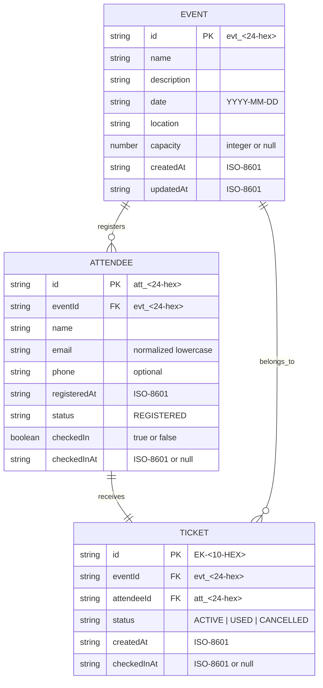
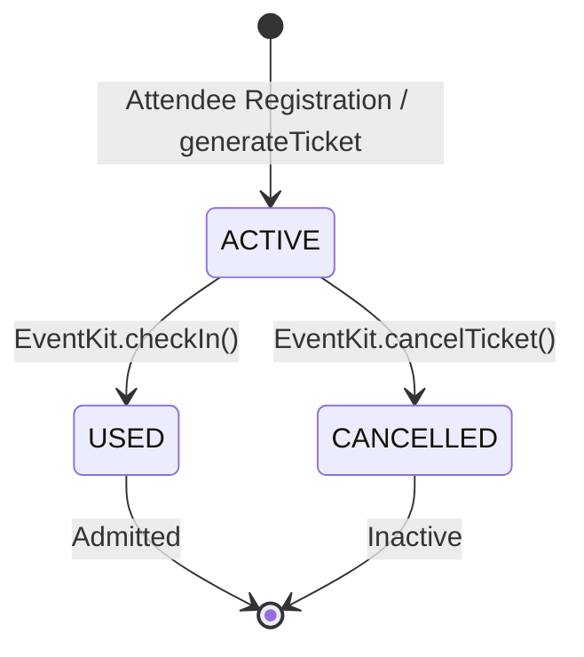

# EventKit

A lightweight, zero-database Node.js toolkit for event registration, digital ticketing, QR code generation, ticket validation, attendee check-in, attendance analytics, search, and data export.

[](https://www.npmjs.com/package/eventkit)
[](https://opensource.org/licenses/MIT)
[](https://nodejs.org)
[](https://github.com/nsaky/eventkit/actions/workflows/tests.yml)

---

## Table of Contents

- [What does EventKit do?](#what-does-eventkit-do)
- [How do I install it?](#how-do-i-install-it)
- [Which Node.js versions does it support?](#which-nodejs-versions-does-it-support)
- [How do I initialize it?](#how-do-i-initialize-it)
- [How do I create an event?](#how-do-i-create-an-event)
- [How do I register an attendee?](#how-do-i-register-an-attendee)
- [How do I retrieve their ticket?](#how-do-i-retrieve-their-ticket)
- [How do I generate a QR code?](#how-do-i-generate-a-qr-code)
- [How do I validate and check in a ticket?](#how-do-i-validate-and-check-in-a-ticket)
- [How do I retrieve attendance statistics?](#how-do-i-retrieve-attendance-statistics)
- [How do I export records?](#how-do-i-export-records)
- [Where is data stored?](#where-is-data-stored)
- [How do I handle errors?](#how-do-i-handle-errors)
- [What are the package's limitations?](#what-are-the-packages-limitations)
- [Complete API Reference](#complete-api-reference)
- [Data Models & Lifecycle](#data-models--lifecycle)
- [Runnable Examples](#runnable-examples)
- [License](#license)

---

## What does EventKit do?

EventKit provides an all-in-one, modular backend toolkit for handling event logistics in Node.js applications without setting up an external database. 

It handles the full lifecycle from registration to arrival:
1. **Event Creation & Management**: Create and update events with capacity limits, dates, and locations.
2. **Attendee Registration**: Collects participant details, normalizes email addresses, prevents duplicate registrations per event, and enforces capacity.
3. **Automatic Digital Ticketing**: Instantly generates cryptographically secure unique ticket IDs (`EK-<10-HEX>`) for every attendee.
4. **Scannable QR Codes**: Renders high-resolution QR codes in **PNG** (Buffer) or **SVG** (vector string) formats encoding non-PII ticket references (`{ ticketId, eventId }`).
5. **Non-Destructive Validation**: Inspects ticket authenticity and checks whether a ticket is valid, cancelled, from another event, or already used.
6. **Arrival Check-In**: Checks in attendees, sets ticket status to `USED`, marks the attendee as admitted, records arrival timestamps, and prevents duplicate check-ins.
7. **Attendance Analytics**: Calculates real-time attendance rates, headcounts, pending counts, and capacity fill percentages.
8. **Roster Search & Export**: Search participants by name, email, or ticket ID, and export complete rosters to formatted JSON or RFC 4180 compliant CSV files.

---

## How do I install it?

Install EventKit into your Node.js project using npm:

```bash
npm install eventkit
```

---

## Which Node.js versions does it support?

EventKit supports maintained **Node.js LTS releases**:

- **Node.js 22**
- **Node.js 24**
- **Node.js 26**
- Minimum supported engine: **`node >= 22.0.0`**
- Module system: **CommonJS** (`const EventKit = require('eventkit');`)

---

## How do I initialize it?

Initialize EventKit before calling any domain methods. You can optionally supply a custom storage directory path:

```javascript
const EventKit = require('eventkit');

async function setup() {
  // Uses default './eventkit-data' directory:
  await EventKit.initialize();

  // Or configure a custom storage path:
  await EventKit.initialize({
    storagePath: './my-event-data'
  });
}
```

- Relative paths are resolved against your project's current working directory (`process.cwd()`).
- If the directory or JSON files do not exist, EventKit creates them automatically.
- Re-initializing with a different path safely switches storage and flushes the in-memory cache without stale data.

---

## How do I create an event?

Use `EventKit.createEvent(data)`:

```javascript
const event = await EventKit.createEvent({
  name: 'Tech Summit 2026',
  description: 'Annual technology conference',
  date: '2026-12-15',      // Calendar date in YYYY-MM-DD format
  location: 'Pune',
  capacity: 200             // Optional positive integer, or null for unlimited
});

console.log(event);
// {
//   id: 'evt_a1b2c3d4e5f60718293a4b5c',
//   name: 'Tech Summit 2026',
//   description: 'Annual technology conference',
//   date: '2026-12-15',
//   location: 'Pune',
//   capacity: 200,
//   createdAt: '2026-11-16T10:00:00.000Z',
//   updatedAt: '2026-11-16T10:00:00.000Z'
// }
```

- Event IDs are generated automatically with the prefix `evt_`.
- Dates are strictly validated for calendar correctness (impossible dates like `2026-02-30` are rejected).

---

## How do I register an attendee?

Use `EventKit.registerAttendee(eventId, attendeeData)`:

```javascript
const attendee = await EventKit.registerAttendee(event.id, {
  name: 'John Doe',
  email: 'John.Doe@Example.com', // Automatically trimmed and converted to lowercase
  phone: '+919876543210'          // Optional contact number
});

console.log(`Attendee ID: ${attendee.id}`);
console.log(`Assigned Ticket ID: ${attendee.ticket.id}`);
```

- **Automatic Ticket Generation**: Every registration automatically generates and returns a linked ticket object.
- **Duplicate Prevention**: The same normalized email address cannot register more than once for the same event (throws `DuplicateRegistrationError`).
- **Capacity Enforcement**: If the event has reached its maximum capacity, registrations are rejected (throws `EventCapacityReachedError`).

---

## How do I retrieve their ticket?

You can access tickets in multiple ways:

```javascript
// 1. Directly from the registration response:
const ticketId = attendee.ticket.id;

// 2. By ticket ID:
const ticket = await EventKit.getTicket('EK-7F92A1C4D8');
console.log(ticket.status); // 'ACTIVE'

// 3. From attendee record lookup:
const attendeeRecord = await EventKit.getAttendee(attendee.id);
console.log(attendeeRecord.ticket);

// 4. Retrieve all tickets belonging to an event:
const eventTickets = await EventKit.getTickets(event.id);

// 5. Retrieve all tickets across all events:
const allTickets = await EventKit.getAllTickets();
```

---

## How do I generate a QR code?

Use `EventKit.generateQRCode(ticketId, options)`. EventKit supports both **PNG** (image Buffer) and **SVG** (vector XML string):

```javascript
// Generate PNG and save to disk
const pngQR = await EventKit.generateQRCode('EK-7F92A1C4D8', {
  format: 'png',              // 'png' (default) or 'svg'
  width: 300,                 // Width in pixels (default 300)
  margin: 2,                  // Quiet zone border modules (default 2)
  errorCorrectionLevel: 'M',  // 'L', 'M', 'Q', 'H' (default 'M')
  filePath: './tickets/ticket.png',
  overwrite: true
});

console.log(`PNG saved to: ${pngQR.filePath}`);
console.log(`Buffer length: ${pngQR.data.length} bytes`);

// Or generate an SVG string directly:
const svgQR = await EventKit.generateQRCode('EK-7F92A1C4D8', {
  format: 'svg'
});
console.log(svgQR.data); // '<svg ... </svg>'
```

- **Non-PII Payload**: Encodes minimal JSON reference `{ "ticketId": "...", "eventId": "..." }`. No personal information (names, emails, phone numbers) is embedded in the QR image.

---

## How do I validate and check in a ticket?

### 1. Validate (Non-destructive inspection)
Before checking an attendee in, validate their ticket without modifying any records:

```javascript
const validation = await EventKit.validateTicket(event.id, 'EK-7F92A1C4D8');

console.log(validation.valid);   // true or false
console.log(validation.status);  // 'VALID' | 'INVALID' | 'WRONG_EVENT' | 'ALREADY_CHECKED_IN' | 'CANCELLED'
console.log(validation.message); // Human-readable explanation
```

### 2. Check-In (Admit attendee)
Admit the attendee at the gate:

```javascript
const checkIn = await EventKit.checkIn(event.id, 'EK-7F92A1C4D8');

console.log(checkIn.message);      // 'Attendee John Doe successfully checked in.'
console.log(checkIn.checkedInAt);  // '2026-11-16T12:00:00.000Z'
```

- **Atomic Synchronization**: Updates ticket `status` to `USED` and attendee `checkedIn` to `true`.
- **Duplicate Check-in Prevention**: Calling `checkIn` again on the same ticket throws `AlreadyCheckedInError` and preserves the original check-in timestamp.
- **Check Status Anytime**:
  ```javascript
  const status = await EventKit.getCheckInStatus('EK-7F92A1C4D8');
  console.log(status.checkedIn); // true
  ```
- **List All Admitted Attendees**:
  ```javascript
  const admitted = await EventKit.getCheckedInAttendees(event.id);
  ```

---

## How do I retrieve attendance statistics?

Use `EventKit.getAttendanceStats(eventId)`:

```javascript
const stats = await EventKit.getAttendanceStats(event.id);

console.log(stats);
// {
//   eventId: 'evt_a1b2c3d4e5f60718293a4b5c',
//   eventName: 'Tech Summit 2026',
//   totalRegistrations: 150,
//   totalCheckedIn: 120,
//   totalPending: 30,
//   attendancePercentage: 80.0,      // (120 / 150) * 100
//   capacity: 200,                   // null if unlimited
//   registrationPercentage: 75.0     // (150 / 200) * 100
// }
```

- Accurately derived from persistent records in real time.
- Handles empty events safely without division-by-zero errors.

---

## How do I export records?

Export participant rosters in **CSV** (RFC 4180 compliant) or **JSON**:

### Export Attendees
```javascript
// Export as formatted CSV string or save to file
const csvResult = await EventKit.exportAttendees(event.id, 'csv', {
  filePath: './exports/attendees.csv',
  overwrite: true
});

console.log(`CSV saved to: ${csvResult.filePath}`);
```

**CSV Format Columns**:
- `Attendee ID`, `Attendee Name`, `Email Address`, `Phone Number`, `Ticket ID`, `Ticket Status`, `Registration Timestamp`, `Attendance Status`, `Check-in Timestamp`
- Correctly escapes quotes, commas, line breaks, and Unicode text.

### Export Full Event Snapshot (JSON)
```javascript
const jsonResult = await EventKit.exportEvent(event.id, 'json', {
  filePath: './exports/event-snapshot.json',
  overwrite: true
});
```

---

## Where is data stored?

All data is stored locally in human-readable JSON files inside the storage directory (default: `./eventkit-data/`):

```text
eventkit-data/
├── events.json      # Array of event records
├── attendees.json   # Array of registered attendee records
└── tickets.json     # Array of digital ticket records
```

- **Atomic File Writes**: Records are serialized and written through temporary files (`.<file>.<timestamp>.<random>.tmp`) and renamed into place, guaranteeing file system integrity against crashes.
- **In-Process Concurrency Protection**: Write operations are serialized via an internal async mutex (`runExclusive`), preventing race conditions during concurrent registrations or check-ins.
- **Restart Persistence**: Data remains permanently intact across Node.js process terminations and restarts.

---

## How do I handle errors?

EventKit exports custom error classes extending `EventKitError`. Every error contains an informative message and a machine-readable `code` property:

```javascript
const EventKit = require('eventkit');
const {
  EventNotFoundError,
  DuplicateRegistrationError,
  EventCapacityReachedError,
  AlreadyCheckedInError,
  TicketCancelledError,
  WrongEventError
} = EventKit.errors;

try {
  await EventKit.checkIn(eventId, ticketId);
} catch (err) {
  if (err instanceof AlreadyCheckedInError) {
    console.warn(`Already admitted at: ${err.context.checkedInAt}`);
  } else if (err instanceof TicketCancelledError) {
    console.error('Ticket has been cancelled.');
  } else if (err instanceof WrongEventError) {
    console.error('Ticket was issued for a different event.');
  } else {
    console.error(`[${err.code}] ${err.message}`);
  }
}
```

### Stable Error Codes Reference

| Error Code | Error Class | Description |
| :--- | :--- | :--- |
| `NOT_INITIALIZED` | `NotInitializedError` | API method called before `EventKit.initialize()`. |
| `EVENT_NOT_FOUND` | `EventNotFoundError` | Event ID does not exist in storage. |
| `ATTENDEE_NOT_FOUND` | `AttendeeNotFoundError` | Attendee ID does not exist in storage. |
| `TICKET_NOT_FOUND` | `TicketNotFoundError` | Ticket ID does not exist in storage. |
| `INVALID_EVENT_DATA` | `InvalidEventDataError` | Missing name, invalid date, or negative capacity. |
| `INVALID_ATTENDEE_DATA`| `InvalidAttendeeDataError` | Missing name or invalid phone number. |
| `INVALID_EMAIL` | `InvalidEmailError` | Malformed email syntax. |
| `DUPLICATE_REGISTRATION`| `DuplicateRegistrationError`| Email already registered for this event. |
| `EVENT_CAPACITY_REACHED`| `EventCapacityReachedError` | Event has reached its configured capacity. |
| `TICKET_ALREADY_EXISTS`| `TicketAlreadyExistsError` | Attendee already has an issued ticket. |
| `TICKET_ALREADY_USED` | `TicketAlreadyUsedError` | Attempted to cancel an already used ticket. |
| `TICKET_CANCELLED` | `TicketCancelledError` | Attempted to check in a cancelled ticket. |
| `WRONG_EVENT` | `WrongEventError` | Ticket belongs to a different event. |
| `ALREADY_CHECKED_IN` | `AlreadyCheckedInError` | Ticket has already been checked in. |
| `INVALID_QR_FORMAT` | `InvalidQRFormatError` | Format other than `'png'` or `'svg'`. |
| `QR_GENERATION_FAILED`| `QRGenerationFailedError` | QR rendering or disk writing failure. |
| `UNSUPPORTED_EXPORT_FORMAT`| `UnsupportedExportFormatError`| Format other than `'json'` or `'csv'`. |
| `FILE_ALREADY_EXISTS` | `FileAlreadyExistsError` | File exists on disk and `overwrite: false`. |
| `STORAGE_CORRUPTED` | `StorageCorruptedError` | Stored JSON file cannot be parsed. |
| `STORAGE_ERROR` | `StorageError` | File system permission or I/O failure. |

---

## What are the package's limitations?

EventKit is intentionally designed to be lightweight, self-contained, and database-free. When designing your architecture, keep these boundaries in mind:

- **Single-Process Storage**: Write serialization protects against concurrent operations within a single Node.js process. It is not designed for multi-server clusters or distributed file systems without an application-level proxy.
- **No Built-in Authentication**: Login sessions, RBAC permissions, and admin gates are managed by your host application (Express, Fastify, Next.js, etc.).
- **No Direct Email/SMS Delivery**: EventKit generates tickets and QR code images; emailing or texting them to attendees is handled by your preferred transport (Nodemailer, SendGrid, Twilio, etc.).
- **No Built-in Payment Gateway**: Payment collection is handled by your application before calling `EventKit.registerAttendee()`.
- **External Camera Scanner**: EventKit generates standard scannable QR codes and validates their decoded ticket IDs; camera video stream decoding is handled on the mobile device or browser.

---

## Complete API Reference

### Initialization
- `await EventKit.initialize(options)`

### Event Operations
- `await EventKit.createEvent(data)`
- `await EventKit.getEvent(eventId)`
- `await EventKit.getAllEvents()`
- `await EventKit.updateEvent(eventId, updates)`
- `await EventKit.deleteEvent(eventId)` *(cascades to attendees & tickets)*

### Attendee Operations
- `await EventKit.registerAttendee(eventId, attendeeData)` *(automatically issues ticket)*
- `await EventKit.getAttendee(attendeeId)`
- `await EventKit.getAttendees(eventId)`
- `await EventKit.removeAttendee(attendeeId)` *(cascades to ticket)*

### Ticket Operations
- `await EventKit.generateTicket(attendeeId, options)` *(standalone ticket creation)*
- `await EventKit.getTicket(ticketId)`
- `await EventKit.getAllTickets()`
- `await EventKit.getTickets(eventId)`
- `await EventKit.validateTicket(eventId, ticketId)` *(read-only validation)*
- `await EventKit.cancelTicket(ticketId)`
- `await EventKit.generateQRCode(ticketId, options)`

### Check-in Operations
- `await EventKit.checkIn(eventId, ticketId)`
- `await EventKit.getCheckInStatus(ticketId)`
- `await EventKit.getCheckedInAttendees(eventId)`

### Analytics & Search
- `await EventKit.getAttendanceStats(eventId)`
- `await EventKit.searchAttendees(eventId, query, options)`
- `await EventKit.searchTicket(ticketId)`

### Export Operations
- `await EventKit.exportAttendees(eventId, format, options)`
- `await EventKit.exportEvent(eventId, format, options)`

---

## Data Models & Lifecycle

### Entity Relationship Model



### Ticket Status Lifecycle



---

## Runnable Examples

The repository includes runnable, documented examples in the [`examples/`](examples/) directory:

| Script | Purpose | Command |
| :--- | :--- | :--- |
| [`examples/basic-usage.js`](examples/basic-usage.js) | Event creation, attendee registration, capacity checks | `node examples/basic-usage.js` |
| [`examples/complete-workflow.js`](examples/complete-workflow.js) | Full registration-to-check-in workflow with preserved data | `node examples/complete-workflow.js` |
| [`examples/ticket-validation.js`](examples/ticket-validation.js) | Testing ticket validation states (`VALID`, `WRONG_EVENT`, etc.) | `node examples/ticket-validation.js` |
| [`examples/qr-generation.js`](examples/qr-generation.js) | PNG buffer and SVG QR generation with disk saving | `node examples/qr-generation.js` |
| [`examples/data-export.js`](examples/data-export.js) | CSV (with quotes & commas) and JSON event snapshot export | `node examples/data-export.js` |

---

## License

EventKit is open-source software licensed under the **[MIT License](LICENSE)**.

```text
MIT License
Copyright (c) 2026 Yasir Eqbal
```
